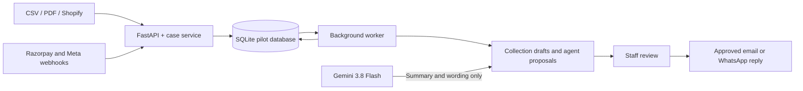

# RecoverFlow — Retail collections through Release 3

RecoverFlow is an English-language receivables and collections pilot for retailers selling on invoice or credit terms. It tracks the outstanding ledger balance, helps staff review and contact customers, connects retail and payment events, and offers a **controlled agent** that proposes work without taking control of money or customer communication.

The selected India pilot uses **Shopify**, **Razorpay**, **Meta WhatsApp Cloud API**, and **Gemini 3.8 Flash**. The user's local Shopify test store has been connected and queried successfully. The current Razorpay hackathon path uses **mock test credentials and a signed payment simulator**; its links are not real payable Razorpay links. WhatsApp is still unconfigured. The Gemini key is present in the local `.env` and its model access was verified, but a live generation check returned HTTP 503 (temporary model demand). Until a generation call succeeds, assessments fall back to clearly labelled rules-based wording. Account secrets live in `.env`, never in this repository.

| Release | Delivered scope | Human control |
| --- | --- | --- |
| **1 — Reliable assisted collections** | CSV and PDF intake, receivable cases, cent-based ledger, reconciliation review, collection drafts, reports, audit trail | Staff confirm extracted invoices, record or verify payments, and approve contact |
| **2 — Connected recovery** | Shopify read-only credit-term sync, Razorpay payment links and signed callbacks, WhatsApp inbox and reply path, draft schedule, provider exception review | Staff confirm Shopify balance and approve messages; simulated payments stay test-only |
| **3 — Controlled agent** | Case and conversation summary, next-action proposal, routine reply draft, opt-in hourly assessment, limited internal notes and unsent drafts | Rules select actions; Gemini writes wording; staff explicitly send customer replies |

Read [Release 2 connection steps](docs/release2-connected-recovery.md) and [Release 3 controls and setup](docs/release3-controlled-agent.md) before enabling those features.

## How it fits together



The **ledger is authoritative inside RecoverFlow**. Shopify remains read-only. Razorpay payment callbacks must pass signature, ID, amount, currency, and captured-status checks before a ledger entry is posted. The agent reads case facts and may save only internal notes or unsent drafts under a tenant policy. It cannot post payments, create payment links, update Shopify, resume cases, or send customer messages by itself.

## What works

| Area | Current behavior |
| --- | --- |
| Retail receivables | Import UTF-8 CSV records with stable external IDs, or create an AR invoice manually. Reimporting identical records skips them; conflicts are rejected. |
| PDF invoices | Upload AP or AR PDFs into a database-backed processing queue. Run a separate worker to process them. Extracted AR invoices require staff confirmation before collection. OCR requires Tesseract, Poppler, `pdf2image`, and `pytesseract`. |
| Balances | New invoices store an opening amount in integer cents. Immutable payment, credit, and reversal entries update the outstanding balance. Existing floating-point amounts remain readable through a rounded legacy fallback. |
| Cases | Staff can inspect a receivable balance and history, record payments or customer replies, and pause contact for disputes, paid claims, or opt-outs. An admin must document a reason before resuming; opt-outs also require confirmation that contact permission was restored. |
| Reconciliation | Human approval of an AFIS match records an AR payment; an AFIS transaction cannot be approved for a second invoice in the same tenant. |
| Collections | Drafts use conservative templates and the current outstanding balance. Staff can edit, refresh, and approve a draft, then record contact made through their own email or phone system. API sending additionally requires configured SMTP, dry run disabled, an eligible case, an unchanged balance, and the contact cooldown to have elapsed. |
| Reporting | AR aging uses current balances. The worker stores a daily invoice-based DSO estimate when there are recent AR invoices; forecasting still requires at least 30 snapshots. |
| Access | API keys identify an actor, tenant, and basic role. Data routes are tenant scoped; viewer keys cannot write. Audit events record important staff actions. |
| Shopify pilot | Read-only GraphQL sync imports INR credit-term payment schedules. Signed order webhooks queue a targeted resync or pause affected cases for review. A local worker polls for newer orders. |
| Razorpay pilot | Staff create a full-balance INR payment link. A signed, deduplicated captured-payment webhook posts a payment to the receivables ledger. Conflicts stay in a review queue. |
| WhatsApp pilot | Signed Meta webhooks create an inbox item and pause matching cases. Staff triage messages and can send a reply within 24 hours of the inbound message when Meta is configured. |
| Policy schedule | An admin may opt in to daily draft creation by local timezone and overdue stage. The schedule never sends a collection message automatically. |
| Controlled agent | An admin can enable bounded assessment. Server rules choose an eligible action; Gemini may summarize and write a routine acknowledgement. Only internal notes and unsent drafts may run automatically. Staff review and send customer replies. |

The active LangGraph path performs OCR, duplicate and amount-anomaly checks, candidate payment matching, and deterministic review routing. The amount-anomaly model uses only invoice amount and should not be interpreted as a fraud determination. Collection drafts currently use offline templates; the LLM client and CFO prototype are not part of the Release 1 decision path.

See [the current architecture](docs/architecture.md) for the earlier invoice workflow and the status of older diagrams. Release 2 and Release 3 controls are documented in their dedicated guides.

## Project layout

| Path | Purpose |
| --- | --- |
| `app/main.py`, `app/api/` | FastAPI, authentication middleware, staff and webhook endpoints |
| `app/database/` | ORM models, SQLite setup, compatibility migration, and schema |
| `app/services/` | Ledger, Shopify, Razorpay, Meta, scheduling, Gemini adapter, and controlled agent |
| `app/agents/`, `app/skills/` | Earlier invoice processing graph and extraction/matching skills |
| `app/worker.py` | Restartable PDF job worker, daily DSO, scheduled drafts, Shopify polling, hourly agent scan |
| `frontend/` | Responsive staff dashboard |
| `scripts/simulate_payment.py` | Local signed Razorpay **mock** payment demonstration |
| `tests/` | Release 1–3 API, ledger, provider, policy, and agent safety tests |
| `docs/` | Architecture and release setup/runbooks |

## Local setup

Use Python 3.11+, install `requirements.txt`, and copy `.env.example` to `.env`. Set a long random `RECOVERFLOW_API_KEY`. Review the paths for Tesseract and AFIS. PDF processing needs Tesseract and Poppler; CSV import and manual entry do not. Never commit `.env` or paste provider or model keys into an issue or chat.

```powershell
python -m venv .venv
.\.venv\Scripts\Activate.ps1
python -m pip install -r requirements.txt
Copy-Item .env.example .env
python run.py
```

In a second terminal, start the durable local worker:

```powershell
python -m app.worker
```

`python -m app.worker --once` claims at most one job and refreshes today's DSO snapshot. The API only queues PDFs; a stopped worker leaves them queued. After a crash, an expired processing lease can be claimed again. Failed jobs without an invoice can be retried through the API or dashboard.

Open `http://127.0.0.1:8002` and enter the configured API key. The health endpoint is public at `/api/v1/system/health`. Data requests use `X-RECOVERFLOW-API-KEY`.

For a new installation, startup creates the ORM tables. After pulling changes into an already running installation, **restart both the API and worker** to load Release 3 endpoints, policy tables, and environment settings. Back up the SQLite file before a major upgrade. The pilot keeps legacy APEX environment names, API headers, and database table names for existing installations.

### Configuration map

| Setting | Purpose |
| --- | --- |
| `RECOVERFLOW_API_KEY` | Staff access for the local single-tenant pilot; `RECOVERFLOW_API_KEYS_JSON` supports named tenant/role keys |
| `APEX_DB_PATH` | SQLite database path; the legacy name is retained for compatibility |
| `EMAIL_DRY_RUN`, SMTP fields | Keep dry run on until approved email delivery is tested |
| `SHOPIFY_SHOP_DOMAIN`, `SHOPIFY_ADMIN_ACCESS_TOKEN`, `SHOPIFY_WEBHOOK_SECRET` | Read-only store sync and signed order callbacks |
| `RAZORPAY_MODE`, `RAZORPAY_KEY_ID`, `RAZORPAY_KEY_SECRET`, `RAZORPAY_WEBHOOK_SECRET` | Test/live payment links and signed payment callbacks; `rzp_test_mock...` selects the local **simulator**, not Razorpay's real API |
| `GEMINI_API_KEY`, `AGENT_MODEL`, `GEMINI_RPM_LIMIT`, `GEMINI_RPD_LIMIT` | Optional model wording for the controlled agent; default model ID is `gemini-3.6-flash` with rate limits enforced (15 RPM, 1500 RPD) |

The public webhook paths for the local pilot tenant are `/api/v1/webhooks/shopify/local`, `/api/v1/webhooks/razorpay/local`, and `/api/v1/webhooks/meta-whatsapp/local`. Provider callbacks need a public HTTPS address and their own signature secrets; the staff API key does not authenticate them. Follow the [Release 2 guide](docs/release2-connected-recovery.md) for account scopes, subscriptions, and a sandbox verification sequence.

## Retail CSV format

Use the **Invoices → Import Retail Receivables** form or POST raw `text/csv` to `/api/v1/imports/receivables/csv`. Required headers are `external_id,invoice_number,customer_name,issue_date,due_date,amount`. Optional headers are `customer_email,currency`. Dates use `YYYY-MM-DD`; amount has at most two decimal places. Legacy CSV imports default to USD when currency is absent, so explicitly include `INR` for the India pilot. Each file may contain up to 500 records.

```csv
external_id,invoice_number,customer_name,customer_email,issue_date,due_date,amount,currency
sale-001,INV-001,Example Customer,customer@example.com,2026-10-01,2026-10-15,125.50,INR
```

## Staff workflow

1. Import AR balances, create them manually, or upload a PDF as **Receivable (AR)**.
2. If a PDF produces a review record, confirm or correct its fields under **Invoices Awaiting Review**. A PDF with missing required fields can be retried or entered manually.
3. Open **Cases** to verify the balance and record receipts, credits, or customer replies. Use a unique receipt reference for each balance entry.
4. For an overdue open case, create a collection draft. Check and approve the text under **Collections**. If the balance changes, refresh and approve it again.
5. Contact the customer through your existing channel and record the manual contact. Only after SMTP configuration and an explicit send call can RecoverFlow deliver an approved email. Dry run is enabled by default. An opt-out, dispute, paid claim, paid balance, or active cooldown blocks contact.

### Connected recovery workflow (Release 2)

1. In **Connected Recovery**, check connection status and sync Shopify credit-term orders. Only INR schedules with a due date become receivable cases. Syncs use stable external IDs to avoid duplicate imports.
2. Review the case balance. Staff create a full-balance Razorpay payment link and decide when to share it. **Mock mode returns a demo URL only**; use Razorpay's real test account for an end-to-end payment test.
3. A valid Razorpay callback posts one immutable payment entry. Duplicate callbacks do not post twice. Unknown, mismatched, refunded, or disputed events go to staff review.
4. For a Shopify case, a verified Razorpay payment pauses contact. Staff reconcile the Shopify balance with the RecoverFlow ledger, use **Confirm Shopify case**, and separately decide whether contact may resume. RecoverFlow does not write to Shopify.
5. When Meta is connected, inbound WhatsApp messages enter the inbox and pause matching cases. Staff triage them. A reply can be sent only after an explicit staff action, within the permitted 24-hour customer-service window; opt-outs block replies.
6. An admin may enable the collection schedule. The worker creates **drafts only** at configured stages and local hour. Staff still approve and send.

### Controlled agent workflow (Release 3)

1. Open **Controlled Agent**. An admin enables the tenant policy and chooses daily assessment/action budgets, the maximum balance for automatic collection drafts, and whether hourly assessment and internal actions are allowed. All switches start off.
2. Staff select a case and request **Propose next action**. The worker can also assess cases hourly when opted in. Unchanged case snapshots reuse their proposal instead of spending another model call.
3. The server checks balance, paid state, dispute, opt-out, Shopify review state, contact suppression, recent contact, and retailer stage thresholds. It chooses `no_action`, `staff_review`, `reply_draft`, or `collection_draft`. **Gemini supplies wording only**; a model response cannot override the chosen action or policy.
4. Review the summary, rationale, risk flags, and proposed action. A safe internal note or an unsent collection draft can be saved within the policy limits. The draft then follows the ordinary Collections approval flow.
5. For a recent triaged customer question, staff can edit the reply draft and explicitly send it. The existing Meta configuration, opt-out, 24-hour window, and duplicate-send checks still apply. If Meta is unconfigured, sending returns an error and no message is created.
6. Reject an incorrect proposal. If the balance, case state, conversation, or collection drafts change, the proposal becomes stale and requires a fresh assessment.

### Useful API routes

All staff routes except health use `/api/v1` and the `X-RECOVERFLOW-API-KEY` header. The interactive schema is available at `/docs` while the server runs.

| Route | Use |
| --- | --- |
| `POST /imports/receivables/csv`, `POST /invoices/manual`, `POST /invoices/upload` | Intake |
| `GET /cases`, `GET /cases/{id}`, `POST /cases/{id}/entries` | Cases and ledger |
| `GET /dunning/campaigns`, `POST /dunning/trigger-stage`, `POST /dunning/campaigns/{id}/approve` | Draft and approve contact |
| `POST /sync/shopify`, `POST /sync/shopify/cases/{id}/confirm` | Read-only sync and balance confirmation |
| `POST /payments/links`, `GET /integrations/events` | Payment link and provider exception review |
| `GET /messages/inbox`, `POST /messages/{id}/triage`, `POST /messages/{id}/reply` | WhatsApp staff workflow |
| `GET /agent/status`, `PUT /agent/policy`, `POST /agent/cases/{id}/assess` | Agent setup and assessment |
| `GET /agent/proposals`, `POST /agent/proposals/{id}/internal/{action}`, `POST /agent/proposals/{id}/send-reply` | Review and controlled execution |

## Tests and demonstrations

```powershell
python -m pytest -q
```

The automated suite covers invoice intake, tenant and role access, signed and duplicate webhooks, ledger posting, Shopify review gates, WhatsApp triage, scheduling, agent opt-in, stale assessments, internal limits, prompt-injection attempts, and staff-reviewed reply idempotency. Release 3 was verified locally with **38 passing tests** and a desktop/mobile dashboard smoke check. Model request tests use a fake Gemini response. A live model metadata request succeeded with the local key, but a synthetic generation request returned HTTP 503 from Gemini; successful live generation remains unverified.

For the hackathon payment demonstration, run the API with the `rzp_test_mock...` configuration from the local `.env`, then use:

```powershell
python scripts/simulate_payment.py --invoice-id 1
```

That script dispatches a locally signed simulated callback. Its success confirms RecoverFlow's callback and ledger path, **not an actual Razorpay charge or settlement**. Use a real Razorpay test account and provider webhook before claiming payment integration is live.

## Operational limits and next steps

- Shopify access is read-only. A balance mismatch, cancellation, payment, paid claim, or dispute requires staff review. A refund callback pauses contact; it does not invent a reversal.
- The WhatsApp path is coded but not connected in the supplied pilot status. Proactive approved-template campaigns, media handling, and delivery tracking still need implementation and provider tests.
- Gemini model access was verified with the key in the local `.env`; live text generation still needs a successful check after the temporary HTTP 503. If generation fails, RecoverFlow marks the assessment as a rules fallback and does not automatically execute its proposed internal action. Customer messages sent to the model may contain personal data; the retailer must approve that data flow before enabling it.
- SQLite, local API keys, and environment-scoped provider secrets are suitable for a small local pilot. A production multi-store service needs managed identity, tenant-specific credential storage, a production database with migrations, backups, monitoring, deployment controls, and an audit review process.
- Keep the API and worker running for asynchronous processing. Monitor queued jobs, provider events needing review, pending collection drafts, and agent proposals. Back up the database before upgrades and rehearse restore before a production rollout.

RecoverFlow is **ready for Release 3 pilot testing**, with internal-only autonomy. It is not yet a production autonomous collections service. The [Release 2](docs/release2-connected-recovery.md) and [Release 3](docs/release3-controlled-agent.md) guides contain the detailed account setup and safety boundaries.
