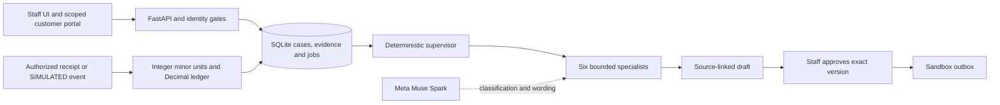

# RecoverFlow AI

**Chase only the money that is actually owed.**

RecoverFlow helps Indian distributors and wholesalers manage credit sales when customers make partial payments or dispute part of a bill. It links evidence to balances, separates disputed from undisputed amounts, prepares collection messages, and asks staff to approve the exact wording.

**Meta Muse Spark powers the optional AI assistance.** The repository integrates `muse-spark-1.3` through the Meta Model API for classification, wording, and document extraction. Server rules own money calculations and permissions. Synthetic demos work offline with rules fallback.

Payments in the demo are **SIMULATED**. Messages go to sandbox outboxes. Shopify access is read-only. This is a tested local application, not a validated production deployment or a proven recovery business.

## A concrete example

An invoice totals INR 2,40,000. The customer has paid INR 1,50,000 and disputes INR 30,000. RecoverFlow shows INR 90,000 outstanding and prepares a request for **only INR 60,000**.

Staff inspect the sources, edit the draft, and approve its exact version and hash. A verified SIMULATED payment of INR 60,000 leaves the case `PARTIALLY_RESOLVED`, with INR 30,000 still disputed. A promise, draft, or sandbox send never counts as payment. Credit adjustments remain separate from cash; full credit-adjusted closure is `RESOLVED_ADJUSTED`.

## Run locally

Python 3.12 is the verified runtime. From the repository root:

```powershell
python -m venv .venv
.\.venv\Scripts\Activate.ps1
python -m pip install -r requirements.txt
Copy-Item .env.example .env
```

On macOS/Linux, activate with `source .venv/bin/activate` and copy with `cp`. Set a private `RECOVERFLOW_API_KEY` in `.env`; never commit it. Keep payment live mode and messaging toggles disabled. To run separately from an existing app, select a new database and free port:

```powershell
$env:DATABASE_URL = ""
$env:APEX_DB_PATH = "recoverflow-demo.db"
$env:PORT = "8138"
python scripts/seed_hero_case.py
python run.py
```

Open [the local app](http://127.0.0.1:8138), enter your API key, and use **Intake**, **Review and Negotiate**, and **Control**. Seeding replaces the named synthetic hero case: use a disposable database. The default port is 8002. Back up existing databases before migration; see [database operations](docs/ops-backup.md).

For Meta assistance, set `META_MODEL_API_KEY`, or role slots `META_API_KEY_1`, `META_API_KEY_2`, and `META_API_KEY_3`. Defaults are `AGENT_MODEL=muse-spark-1.3` and `META_API_BASE_URL=https://api.meta.ai/v1`. The client caps each slot at 15 requests/minute and 1,500/day with rules fallback. These are application limits, not provider entitlement claims. No live model call was made in the latest verification. Without model access, unreadable documents may require staff entry.

## Offline demos

```powershell
python scripts/demo_p1_showcase.py
```

The showcase uses isolated synthetic data: a Hinglish claim, conflicting evidence, an ambiguous transfer held for staff, rejection of stale approval, an edited draft, and SIMULATED payment with an open dispute.

The hero demo and evaluation scripts regenerate report files. Run them in a disposable source copy to preserve published reports:

```powershell
$demoCopy = Join-Path $env:TEMP ("recoverflow-demo-" + [guid]::NewGuid().ToString("N"))
robocopy . $demoCopy /E /R:2 /W:1 /XD .git .venv .codex __pycache__ .pytest_cache node_modules data backups scratch tmp /XF *.db* .env
# Robocopy codes 0-7 indicate success; 8 or higher indicates failure.
Push-Location $demoCopy
python scripts/demo_hero.py
python scripts/run_p1_evaluation.py
Pop-Location
```

Use the activated Python environment above. Neither demo needs an API key or internet after dependencies are installed.

## Architecture and agents



The six specialists cover **intake, investigation, reconciliation, resolution, communication, and verification**. The supervisor persists attempts, budgets, leases, results, and review gates. Specialist tool allowlists exclude payment posting, approval, waivers, and sending. Case fingerprints invalidate stale output and approvals. Customer text and uploads are evidence, never instructions.

| Capability | Implemented behavior |
| --- | --- |
| Accounting and evidence | Separate cash/credit/debit/reversal categories, dispute allocation, source references, staff trust decisions and seven canonical case stages. |
| Investigation | Invoice/PO/delivery/return/scheme comparisons, competing explanations and clarification tasks; uncertain units or tax/freight allocation require staff input. |
| Allocation and installments | Scored transfer candidates, split allocations, ambiguity review, nonfinancial promises, installment applications and reversal history. |
| Staff workflow | Versioned EN/HI/Hinglish drafts, negotiation handover, owner queue, activity, assignments, notes, escalation and role gates. |
| Identity and documents | Counterparties, branches, format-checked GSTINs, confirmed merges, private documents, hashes, quarantine, holds and retention. |
| Customer portal | Expiring, revocable single-invoice tokens; submitted disputes and payment references remain claims for review. |
| Integration rails | Generic CSV runs, conflicts, signed events, payment discrepancies and settlement matching; external providers remain mock/sandbox tested. |
| Operations and privacy | 18 migrations, SQLite backup/restore, worker retries/dead letters, metrics, pull alerts, admin privacy requests and economics assumptions. |

## Verification and roadmap

On 2026-10-30, the isolated Python 3.12 suite passed **342 tests** after seven defects were fixed. Both demos passed. The hero run measured **30/30** balance splits, **10/10** file-routing checks and **5/10** files reaching review without data entry. These are synthetic checks, not recovery or real-document accuracy claims.

The 38-case P1 comparison evaluates rules, one service pass, and the specialist workflow with model access forced off. It includes failures and does not establish a live-model or multi-agent advantage. See the [evaluation method](docs/p1-evaluation.md) and [verification report](docs/verification-2026-10-30.md), including exact commands, fixes, blockers and the **17-workstream status table**.

```powershell
$env:DATABASE_URL = ""
$env:APEX_DB_PATH = Join-Path $env:TEMP "recoverflow-test-bootstrap.db"
python -m pytest -q --disable-warnings
node --check frontend/app.js
node --check frontend/portal.js
node --check frontend/config.js
git diff --check
```

P0 and P1 core workflows are implemented and regression-tested. P2 local capabilities are implemented with explicit limits. PostgreSQL, accounting-vendor formats, provider-account tests, legal/accountant review, real-business pilots and willingness-to-pay research remain unverified or blocked. P2 is not universally production-complete.

## API and project structure

Interactive API documentation is at `/docs`; routes start with `/api/v1`. Staff requests use `X-RECOVERFLOW-API-KEY` or bearer sessions. Health is public; signed webhooks and customer portal tokens have separate verification.

| Route families | Purpose |
| --- | --- |
| `/auth`, `/team`, `/counterparties` | Identity, roles, assignments and business records |
| `/intake`, `/imports`, `/cases` | Uploads, confirmed imports, case evidence and private documents under `/cases/{id}/stored-documents` |
| `/supervisor`, `/agent`, `/negotiations` | Specialist tasks, draft review and negotiation controls |
| `/allocations`, `/cases/{id}/schedules`, `/payments`, `/webhooks` | Allocations, installments and payment events |
| `/portal`, `/privacy`, `/system` | Customer submissions, privacy requests, health, migrations, jobs and reports |

`app/api/`: routes; `app/services/`: rules and orchestration; `app/database/`: models and migrations; `frontend/`: plain JavaScript UI; `tests/`: regressions; `scripts/`: demos, evaluations and backup tools; `docs/`: methods and operating guidance.

## Explicit limits

- The ledger is an adjustment log, not double-entry accounting. AXIS reads a local tax database; it is not an Axis Bank connection.
- SQLite is verified. PostgreSQL has an implementation path but no instance-backed validation in this run.
- Payments remain SIMULATED and messaging sandbox-only. No Tally, BUSY or Zoho format support is claimed from a product name.
- Policy checks reduce injection risk without proving immunity. Multilingual and real-document reliability need field measurement.
- Document type/hash checks are not antivirus scans. An AV engine is not connected.
- Separation of duties permits a lone operator with an audit note. Static bootstrap keys remain supported; deployment and credential governance need operational review.
- Privacy workflows have limited erasure scope and retain accounting/audit records. They are not a legal-compliance claim.
- Economics uses supplied price assumptions and omits intake/vision model metering. Synthetic concurrency tests are not a distributed exactly-once guarantee or production load test.

Further reading: [architecture](docs/architecture.md), [supervisor](docs/supervisor.md), [permissions](docs/auth-permissions.md), [document security](docs/document-security.md), [runbook](docs/runbook.md), [privacy](docs/privacy.md), [validation plan](docs/validation-plan.md), [economics](docs/economics.md).
