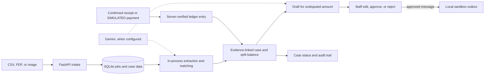

# RecoverFlow AI

RecoverFlow is a local receivables workbench for teams handling overdue invoices, partial payments, and disputes. It links invoice, purchase order, receipt, and customer-message evidence to a case; calculates the outstanding balance; separates the disputed portion from the amount that can be requested; and prepares a collection message for staff review. Server-side rules control money and actions. Gemini can assist with document extraction, classification, and wording when configured.

**Demo boundary:** All example documents and customers are synthetic. Razorpay payments in the demo are **SIMULATED**. Outbound WhatsApp and email messages are placed in local sandbox outboxes; the demo does not send them to customers.

## What it does

| Area | Available workflow |
| --- | --- |
| Intake | Upload CSV, PDF, JPEG, or PNG files (up to 10 MB each). A SQLite-backed worker tracks extraction, validation, confidence, and items needing staff attention. Staff confirm extracted invoices and receipts before they affect the ledger. |
| Case review | See invoice total, received, outstanding, disputed, and undisputed amounts, with source links and an audit trail. Purchase orders and messages can supply dispute evidence. |
| Collection drafts | Prepare a request for the undisputed balance only. Staff can edit or reject it; each edit creates a new version, and approval is tied to the exact version. |
| Negotiation | Choose Manual or Delegate mode per case, inspect a sandbox transcript, use co-pilot suggestions, and pause, take over, or stop. Server rules bound offers and block waivers or misstated balances. |
| Payment and control | Match verified ledger entries to cases; a payment can leave the disputed amount open as `PARTIALLY_RESOLVED`. Control shows policy, model-slot status, sandbox activity, ledger, audit, and synthetic evaluation results. |

Incoming customer text is treated as evidence, including attempted instructions to cancel an invoice. A promise to pay or an approved message does not close a case. Shopify integration is read-only and requires staff confirmation of imported balances.

## Architecture and workflow



Only a verified ledger entry changes the paid balance; drafting, approval, and sandbox messages do not.

## Quick start: offline demo

Use Python 3.11 or 3.12. From the repository root, create an environment and install the pinned dependencies:

```powershell
python -m venv .venv
.\.venv\Scripts\Activate.ps1
python -m pip install -r requirements.txt
python scripts/demo_hero.py
```

On macOS or Linux, activate with `source .venv/bin/activate` instead. The demo needs no API key or internet after dependencies are installed. It uses a temporary database and generated documents, then runs intake, evidence review, a versioned draft approval, both negotiation modes, an injection check, and a **SIMULATED** payment. The example invoice is ₹2,40,000: ₹1,50,000 received, ₹90,000 outstanding, ₹30,000 disputed, and ₹60,000 undisputed. After the simulated ₹60,000 payment, the case is `PARTIALLY_RESOLVED` with ₹30,000 still disputed. The script also refreshes [the synthetic evaluation report](docs/evaluation.md).

## Run the web app

For a hosted pilot, follow the [Vercel deployment guide](docs/vercel-deployment.md). Vercel serves the frontend; the API and workers need a persistent Python host.

1. Copy `.env.example` to `.env` (`Copy-Item .env.example .env` in PowerShell, or `cp .env.example .env` on macOS/Linux). Replace `RECOVERFLOW_API_KEY` with a long, private local key. Optionally set `APEX_DB_PATH=recoverflow-local.db` to keep this run in a separate SQLite database. Do not commit `.env`.
2. Seed the example case if you want data immediately: `python scripts/seed_hero_case.py`. This reseeds the example invoice if it already exists in the selected database.
3. Start the server: `python run.py`. Open [http://127.0.0.1:8002](http://127.0.0.1:8002), enter the same staff key, and use **Intake**, **Review and Negotiate**, and **Control**. The API health check is at `/api/v1/system/health`; interactive API documentation is at `/docs`.

The server creates the local database and runs the intake worker in process. The offline parser handles tagged demo PDFs and text PDFs with explicit invoice, purchase-order, or receipt labels whose totals reconcile; staff still confirm extracted invoices and receipts. Scanned images and unrecognized PDFs need Gemini extraction or staff review. Optional Gemini configuration uses `GEMINI_API_KEY_1`, `_2`, and `_3` for intake, investigation/drafting, and negotiation, respectively, with rules fallback when unavailable. The configured model is `gemini-3.6-flash`, with client limits of 15 requests/minute and 1,500/day per slot. Restart the server after adding or changing `.env`.

## Verify and learn more

Run `python -m pytest -q` for the test suite, `node --check frontend/app.js` for JavaScript syntax, and `python scripts/run_evaluation.py` to regenerate the synthetic evaluation. The evaluation reports 30 accounting/policy cases and ten generated upload trials; it does not measure real-world recovery or live document accuracy.

The backend is FastAPI with SQLAlchemy and SQLite by default; the frontend is served from `frontend/`. See the [endpoint inventory](docs/frontend-endpoint-inventory.md), [evaluation method and limits](docs/evaluation.md), [connected-provider guide](docs/release2-connected-recovery.md), and [controlled-agent guide](docs/release3-controlled-agent.md). Local API keys, database-backed users, and roles are implemented, but this is a local pilot: live provider setup, production identity, migrations, backups, and monitoring require further work.
