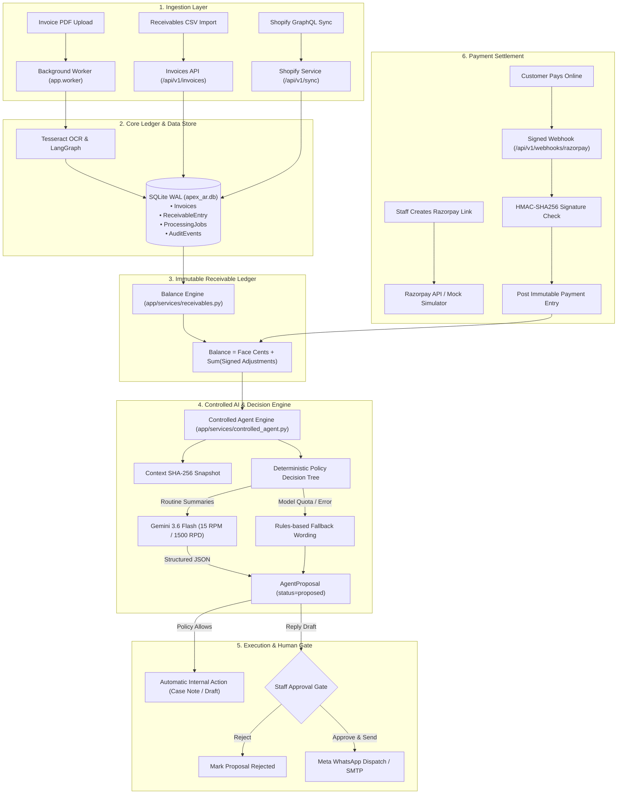
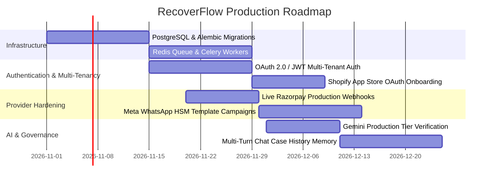

# RecoverFlow: Comprehensive System Architecture, Feature Catalog, and Project State

> **Document Version:** 1.3.0  
> **Last Updated:** 2026-10-24  
> **Target Audience:** Engineering Team, Product Architects, Autonomous Coding Agents (Codex, Antigravity)  
> **Repository Context:** `APEX-main` (RecoverFlow AI Retail Receivables & Controlled Collections)

---

## Table of Contents

1. [Executive Summary & System Purpose](#1-executive-summary--system-purpose)
2. [High-Level Architecture & Core Principles](#2-high-level-architecture--core-principles)
   - [2.1 Architectural Flow Diagram](#21-architectural-flow-diagram)
   - [2.2 Invariant Architectural Guardrails](#22-invariant-architectural-guardrails)
3. [Complete Technology Stack](#3-complete-technology-stack)
4. [File-by-File & Folder-by-Folder Codebase Tour](#4-file-by-file--folder-by-folder-codebase-tour)
   - [4.1 Root Directory](#41-root-directory)
   - [4.2 Agent Collaboration (`.codex/` and `AGENTS.md`)](#42-agent-collaboration-codex-and-agentsmd)
   - [4.3 Application Core (`app/`)](#43-application-core-app)
   - [4.4 Database Layer (`app/database/`)](#44-database-layer-appdatabase)
   - [4.5 REST API Routers (`app/api/`)](#45-rest-api-routers-appapi)
   - [4.6 Domain Services (`app/services/`)](#46-domain-services-appservices)
   - [4.7 Extensible Skills (`app/skills/`)](#47-extensible-skills-appskills)
   - [4.8 Agent Orchestration (`app/agents/`)](#48-agent-orchestration-appagents)
   - [4.9 Machine Learning & Forecasting (`app/ml/`)](#49-machine-learning--forecasting-appml)
   - [4.10 Integration Plugins & Readers (`app/plugins/`)](#410-integration-plugins--readers-appplugins)
   - [4.11 Frontend Single-Page App (`frontend/`)](#411-frontend-single-page-app-frontend)
   - [4.12 Test Suite (`tests/`)](#412-test-suite-tests)
   - [4.13 Scripts, Binaries, and Data (`scripts/`, `bin/`, `data/`)](#413-scripts-binaries-and-data-scripts-bin-data)
5. [Detailed Feature Catalog: Implemented & Functional](#5-detailed-feature-catalog-implemented--functional)
   - [5.1 Release 1: Core Invoicing & Immutable Ledger](#51-release-1-core-invoicing--immutable-ledger)
   - [5.2 Release 2: Connected Recovery Pilot (Shopify + Razorpay + WhatsApp)](#52-release-2-connected-recovery-pilot-shopify--razorpay--whatsapp)
   - [5.3 Release 3: Controlled Agent with Rate Limiting](#53-release-3-controlled-agent-with-rate-limiting)
6. [Simulated, Mocked, & Placeholder Features](#6-simulated-mocked--placeholder-features)
7. [Pending Features & Production Roadmap](#7-pending-features--production-roadmap)
8. [Operational Runbook & Verification](#8-operational-runbook--verification)
9. [Complete Environment Configuration Matrix](#9-complete-environment-configuration-matrix)

---

## 1. Executive Summary & System Purpose

**RecoverFlow** (formerly APEX AR) is an enterprise retailer receivables and assisted debt collection platform designed specifically for merchants managing credit-term sales (B2B and high-value consumer retail).

The project is structured across three evolutionary phases:
- **Release 1 (Assisted Core):** Multi-channel invoice ingestion (PDF OCR via Tesseract and CSV import), double-entry immutable receivable ledger with fixed integer-cent math, durable background workers, automated stage-based dunning drafts, customer dispute/opt-out handling, and Days Sales Outstanding (DSO) tracking.
- **Release 2 (Connected Recovery - India Pilot):** Read-only automated synchronization of credit-term payment schedules from **Shopify GraphQL Admin API**, staff-generated **Razorpay Payment Links**, automated signed webhook verification for payment settlement into the ledger, and two-way **Meta WhatsApp Cloud API** customer communication with strict 24-hour service window enforcement.
- **Release 3 (Controlled Agent Pilot):** Deterministic server-rule decision engine paired with **Google Gemini 3.6 Flash** structured JSON generation for automated case summarization, risk flagging, policy-bounded internal actions (automated case notes and collection drafts), strict client-side sliding window rate limiting (15 RPM, 1,500 RPD), and mandatory human review before any customer-facing communication or money movement.

---

## 2. High-Level Architecture & Core Principles

### 2.1 Architectural Flow Diagram



### 2.2 Invariant Architectural Guardrails

RecoverFlow enforces zero-trust boundaries around AI agents and financial data:

1. **AI Agents Never Touch Money:**
   Neither the LangGraph workflow nor Gemini has access to payment tools, bank write APIs, or ledger credit/debit authorizations. Payment entries are posted *strictly* by verified cryptographic webhooks or authenticated human accountants.
2. **AI Agents Never Message Customers Directly:**
   The AI agent is restricted to generating *internal case notes* and *unsent collection drafts*. All outbound communications (WhatsApp messages, emails) require explicit human staff review and confirmation.
3. **Shopify is Read-Only:**
   RecoverFlow syncs store orders and payment terms to detect receivables. It *never* writes back to Shopify, does *not* alter Shopify order statuses, and does *not* issue refunds. If balances diverge, contact is paused until staff manually confirms the balance.
4. **Integer-Cent Math:**
   All monetary amounts in the ledger are tracked as signed integers representing cents (`amount_cents`). Floating-point arithmetic is strictly prohibited in balance calculations to eliminate IEEE-754 precision errors.
5. **Context Hashing Against Stale Decisions:**
   Every agent proposal stores a SHA-256 hash of the complete case state (balance, flags, messages, drafts). If any balance change or customer reply occurs after assessment, the proposal is immediately marked `stale` and execution is rejected.

---

## 3. Complete Technology Stack

| Layer | Technology | Version | Purpose |
| :--- | :--- | :--- | :--- |
| **Backend Runtime** | Python | `>=3.11, <3.13` | Application execution environment |
| **Web Framework** | FastAPI | `0.115.0` | Asynchronous high-performance REST API |
| **ASGI Server** | Uvicorn | `0.30.6` | HTTP/1.1 and WebSocket server implementation |
| **ORM / Data Access** | SQLAlchemy | `2.0.35` | Relational data mapping and transaction scoping |
| **Data Validation** | Pydantic / Pydantic Settings | `2.9.2 / 2.6.1` | Schema validation and settings management |
| **Database** | SQLite 3 | WAL Mode | Local transactional database with foreign key support |
| **AI / LLM Integration** | Google Gemini API (Direct HTTPX) | `v1beta` | Low-latency structured text generation (`gemini-3.6-flash`) |
| **Workflow Engine** | LangGraph / LangChain Core | `0.2.39 / 0.3.15` | Multi-node invoice processing state graph |
| **OCR Engine** | Tesseract OCR / PyTesseract | `0.3.13` (Bundled Win binaries) | Text extraction from scanned invoice documents |
| **PDF Rendering** | pdf2image / Poppler | `1.17.0` (Bundled Win binaries) | Converting PDF pages to 300 DPI images for OCR |
| **Time Series ML** | Meta Prophet | `1.1.5` | 90-day Days Sales Outstanding (DSO) forecasting |
| **Anomaly Detection** | Scikit-Learn (Isolation Forest) | `1.5.2` | Invoice amount fraud/anomaly scoring |
| **Numerical Processing** | Pandas / NumPy | `2.2.3 / 2.1.2` | Matrix and tabular operations for ML pipelines |
| **String Matching** | RapidFuzz / Difflib | `3.10.1` | Fuzzy matching for duplicate invoices and reconciliations |
| **HTTP Client** | HTTPX | `0.27.2` | Synchronous and asynchronous requests for external APIs |
| **Retry Logic** | Tenacity | `9.0.0` | Exponential backoff for API network calls |
| **Email Protocol** | aiosmtplib | `3.0.2` | Asynchronous SMTP client with dry-run protection |
| **Frontend UI** | Vanilla HTML5, CSS3, ES6+ JS | Native | Ultra-responsive, dependency-free dashboard with Amber theme |
| **Test Framework** | PyTest / PyTest-Asyncio | `8.3.3 / 0.24.0` | Complete unit and integration test suite |

---

## 4. File-by-File & Folder-by-Folder Codebase Tour

### 4.1 Root Directory

- [run.py](file:///c:/Users/Lakshya%20Arora/Documents/APEX-main/run.py): Entry point for launching the FastAPI web server using Uvicorn. Reads `HOST`, `PORT`, and `LOG_LEVEL` from `app.config.settings`.
- [requirements.txt](file:///c:/Users/Lakshya%20Arora/Documents/APEX-main/requirements.txt): Pinned dependencies for Python 3.11/3.12.
- [.env](file:///c:/Users/Lakshya%20Arora/Documents/APEX-main/.env): Active local configuration file containing API keys and server parameters (kept secret).
- [.env.example](file:///c:/Users/Lakshya%20Arora/Documents/APEX-main/.env.example): Exhaustive template documenting all environment variables, expected formats, and security rules.
- [README.md](file:///c:/Users/Lakshya%20Arora/Documents/APEX-main/README.md): Primary user and developer guide detailing local startup, security architecture, and verification.
- [CHANGELOG.md](file:///c:/Users/Lakshya%20Arora/Documents/APEX-main/CHANGELOG.md): Historical record of versions (v1.0.0, v1.1.0, v1.2.0, and unreleased releases 1–3).
- `apex_ar.db`, `apex_ar.db-wal`, `apex_ar.db-shm`: SQLite database files running in Write-Ahead Logging (WAL) mode.
- `pdf_job_result.json`, `workflow_results.json`: Artifact outputs from previous test and demo pipeline runs.

### 4.2 Agent Collaboration (`.codex/` and `AGENTS.md`)

- [AGENTS.md](file:///c:/Users/Lakshya%20Arora/Documents/APEX-main/AGENTS.md): Standing instruction file mandating that Codex and Antigravity read `.codex/prompt.md` and `.codex/handoff.md` before starting, and update `.codex/handoff.md` upon completion.
- [.codex/prompt.md](file:///c:/Users/Lakshya%20Arora/Documents/APEX-main/.codex/prompt.md): The project brief and strict operating procedures for collaborative agents.
- [.codex/handoff.md](file:///c:/Users/Lakshya%20Arora/Documents/APEX-main/.codex/handoff.md): Shared running log of verified iterations, blocker notes, model decisions, and next steps.

### 4.3 Application Core (`app/`)

- [app/main.py](file:///c:/Users/Lakshya%20Arora/Documents/APEX-main/app/main.py):
  - Configures application logging.
  - Registers the FastAPI application (v1.3.0).
  - Implements `protect_api` middleware: intercepts `/api/v1/*` routes (except health checks and webhook callbacks), parses `X-RECOVERFLOW-API-KEY`, validates actor/tenant/role, and enforces viewer read-only protection.
  - Mounts static files from `frontend/`.
- [app/config.py](file:///c:/Users/Lakshya%20Arora/Documents/APEX-main/app/config.py):
  - Defines `Settings(BaseSettings)` reading from `.env`.
  - Defines DB paths, LLM configuration, Gemini 3.6 Flash rate limits (`GEMINI_RPM_LIMIT=15`, `GEMINI_RPD_LIMIT=1500`), OCR paths, ML thresholds, collection stages, and provider credentials.
- [app/auth.py](file:///c:/Users/Lakshya%20Arora/Documents/APEX-main/app/auth.py):
  - Implements API key parsing with `secrets.compare_digest` constant-time comparison.
  - Supports single root keys (`RECOVERFLOW_API_KEY`) and multi-tenant JSON arrays (`RECOVERFLOW_API_KEYS_JSON`).
  - Defines `Identity(actor, tenant_id, role)`.
- [app/llm_client.py](file:///c:/Users/Lakshya%20Arora/Documents/APEX-main/app/llm_client.py):
  - Legacy Anthropic Claude client wrapper with exponential retry decorator (`retry_llm_call`).
- [app/worker.py](file:///c:/Users/Lakshya%20Arora/Documents/APEX-main/app/worker.py):
  - Independent background worker daemon.
  - Runs durable 15-minute lease lock processing for queued invoice jobs.
  - Refreshes rolling 30-day DSO snapshots daily.
  - Executes the hourly collection draft policy scheduler.
  - Executes the 5-minute Shopify order backfill and queued event processor.
  - Executes the hourly controlled agent auto-assessment scanner.

### 4.4 Database Layer (`app/database/`)

- [app/database/models.py](file:///c:/Users/Lakshya%20Arora/Documents/APEX-main/app/database/models.py):
  - Comprehensive SQLAlchemy models: `Invoice`, `ReceivableEntry`, `Reconciliation`, `DunningCampaign`, `FraudAlert`, `DSOSnapshot`, `Counterparty`, `RecoverFlowSetting`, `ProcessingJob`, `AuditEvent`, `CustomerMessage`, `IntegrationConnection`, `PaymentLink`, `ProviderEvent`, `CollectionPolicy`, `InboundMessage`, `OutboundMessage`, `AgentPolicy`, `AgentProposal`, `AgentCaseNote`, `AgentExecution`.
- [app/database/db_manager.py](file:///c:/Users/Lakshya%20Arora/Documents/APEX-main/app/database/db_manager.py):
  - SQLite engine initialization with `PRAGMA journal_mode=WAL`, `PRAGMA synchronous=NORMAL`, and `PRAGMA foreign_keys=ON`.
  - `init_db()` executes idempotent database schema migrations and tenant-scoping for pre-existing databases.
- [app/database/schema.sql](file:///c:/Users/Lakshya%20Arora/Documents/APEX-main/app/database/schema.sql):
  - Raw SQL baseline tables used for fresh local SQLite initializations.

### 4.5 REST API Routers (`app/api/`)

- [app/api/router.py](file:///c:/Users/Lakshya%20Arora/Documents/APEX-main/app/api/router.py): Aggregator mounting 16 subrouters under `/api/v1`.
- [app/api/invoices.py](file:///c:/Users/Lakshya%20Arora/Documents/APEX-main/app/api/invoices.py): PDF stream upload (`POST /upload`), job status polling (`GET /jobs/{id}`), job retry (`POST /jobs/{id}/retry`), manual creation (`POST /manual`), human review confirmation (`PUT /{id}/review`), and invoice search (`GET /`).
- [app/api/cases.py](file:///c:/Users/Lakshya%20Arora/Documents/APEX-main/app/api/cases.py): Retailer receivable cases workspace: listing (`GET /`), detail with ledger/messages/campaigns (`GET /{id}`), manual ledger payment/credit entry (`POST /{id}/entries`), customer reply recording (`POST /{id}/replies`), admin ledger entry reversal (`POST /{id}/entries/{id}/reverse`), and admin collection resume (`POST /{id}/resume`).
- [app/api/payments.py](file:///c:/Users/Lakshya%20Arora/Documents/APEX-main/app/api/payments.py): Razorpay Payment Link management: creation with idempotency key (`POST /links`), admin link cancellation (`POST /links/{id}/cancel`), timeout recovery by reference ID (`POST /links/{id}/recover`), and deprecated legacy endpoints returning HTTP 410.
- [app/api/dunning.py](file:///c:/Users/Lakshya%20Arora/Documents/APEX-main/app/api/dunning.py): Multi-stage collections: manual draft creation (`POST /trigger-stage`), draft edit (`PUT /campaigns/{id}`), draft approval (`POST /campaigns/{id}/approve`), balance refresh (`POST /campaigns/{id}/refresh`), manual contact recording (`POST /campaigns/{id}/record-contact`), and SMTP email send (`POST /campaigns/{id}/send`).
- [app/api/controlled_agent.py](file:///c:/Users/Lakshya%20Arora/Documents/APEX-main/app/api/controlled_agent.py): Release 3 Controlled Agent endpoints: policy inspection and rate limit metrics (`GET /status`), policy update (`PUT /policy`), manual case assessment (`POST /cases/{id}/assess`), proposal listing (`GET /proposals`), internal action execution (`POST /proposals/{id}/internal/{action}`), proposal rejection (`POST /proposals/{id}/reject`), and staff-reviewed WhatsApp reply send (`POST /proposals/{id}/send-reply`).
- [app/api/integrations.py](file:///c:/Users/Lakshya%20Arora/Documents/APEX-main/app/api/integrations.py): Connection status summary (`GET /status`), provider event log (`GET /events`), and admin exception resolution (`POST /events/{id}/resolve`).
- [app/api/webhooks.py](file:///c:/Users/Lakshya%20Arora/Documents/APEX-main/app/api/webhooks.py): Public provider callbacks: Razorpay signed webhooks (`POST /razorpay/{tenant}`), Shopify signed order webhooks (`POST /shopify/{tenant}`), and Meta WhatsApp verification and messaging webhooks (`GET|POST /meta-whatsapp/{tenant}`).
- [app/api/messages.py](file:///c:/Users/Lakshya%20Arora/Documents/APEX-main/app/api/messages.py): WhatsApp message triage: inbox (`GET /inbox`), message assignment and category tagging (`POST /{id}/triage`), and staff outbound reply (`POST /{id}/reply`).
- [app/api/policies.py](file:///c:/Users/Lakshya%20Arora/Documents/APEX-main/app/api/policies.py): Collection draft scheduling policy get/put (`GET|PUT /collection`).
- [app/api/reconciliation.py](file:///c:/Users/Lakshya%20Arora/Documents/APEX-main/app/api/reconciliation.py): AFIS bank transaction matching review (`GET /pending`) and staff approval (`POST /{id}/approve`).
- [app/api/reports.py](file:///c:/Users/Lakshya%20Arora/Documents/APEX-main/app/api/reports.py): Aging distribution (`GET /ar-aging`) and dashboard statistics (`GET /summary`).
- [app/api/sync.py](file:///c:/Users/Lakshya%20Arora/Documents/APEX-main/app/api/sync.py): Shopify synchronization: status (`GET /shopify/status`), order import trigger (`POST /shopify`), and admin balance confirmation (`POST /shopify/cases/{id}/confirm`).
- [app/api/system.py](file:///c:/Users/Lakshya%20Arora/Documents/APEX-main/app/api/system.py): Unauthenticated health check (`GET /health`) and non-sensitive configuration display (`GET /config`).
- [app/api/forecast.py](file:///c:/Users/Lakshya%20Arora/Documents/APEX-main/app/api/forecast.py): 90-day DSO Prophet forecasting (`GET /dso`).
- [app/api/fraud.py](file:///c:/Users/Lakshya%20Arora/Documents/APEX-main/app/api/fraud.py): Isolation Forest fraud alerts listing (`GET /alerts`) and resolution (`POST /{id}/resolve`).
- [app/api/imports.py](file:///c:/Users/Lakshya%20Arora/Documents/APEX-main/app/api/imports.py): Bulk CSV receivable import (`POST /receivables/csv`).

### 4.6 Domain Services (`app/services/`)

- [app/services/receivables.py](file:///c:/Users/Lakshya%20Arora/Documents/APEX-main/app/services/receivables.py): Immutable ledger engine. Implements `cents()` conversion, `opening_cents()`, `balance_cents()`, and atomic `post_entry()` with over-allocation prevention.
- [app/services/controlled_agent.py](file:///c:/Users/Lakshya%20Arora/Documents/APEX-main/app/services/controlled_agent.py): Full decision logic for Release 3. Handles case snapshotting, SHA-256 context hashing, deterministic action routing (`no_action`, `staff_review`, `reply_draft`, `collection_draft`), Gemini invocation with rules fallback, internal action execution, and hourly worker scanning.
- [app/services/gemini_agent.py](file:///c:/Users/Lakshya%20Arora/Documents/APEX-main/app/services/gemini_agent.py): Gemini 3.6 Flash integration. Features `GeminiRateLimiter` (15 RPM sliding window, 1,500 RPD Pacific Time reset), structured JSON output parsing, and `safe_reply()` content filters (blocking URLs, phone numbers, banking instructions, or unverified promises).
- [app/services/razorpay.py](file:///c:/Users/Lakshya%20Arora/Documents/APEX-main/app/services/razorpay.py): Razorpay API connector. Supports remote link creation, link cancellation, query-by-reference recovery, HMAC-SHA256 signature verification, and settlement into the ledger.
- [app/services/shopify.py](file:///c:/Users/Lakshya%20Arora/Documents/APEX-main/app/services/shopify.py): Read-only Shopify GraphQL Admin API client. Fetches credit-term payment schedules, verifies HMAC-SHA256 webhooks, and flags cases needing human review when store balances diverge.
- [app/services/meta_whatsapp.py](file:///c:/Users/Lakshya%20Arora/Documents/APEX-main/app/services/meta_whatsapp.py): Meta WhatsApp Cloud API connector. Handles webhook HMAC-SHA256 signatures, parses inbound messages, links sender phones to receivables, and sends outbound staff replies within 24 hours.
- [app/services/policy_scheduler.py](file:///c:/Users/Lakshya%20Arora/Documents/APEX-main/app/services/policy_scheduler.py): Timezone-aware daily scheduler that drafts collection notices for overdue receivables according to tenant policy.

### 4.7 Extensible Skills (`app/skills/`)

- [app/skills/extract_invoice_fields.py](file:///c:/Users/Lakshya%20Arora/Documents/APEX-main/app/skills/extract_invoice_fields.py): OCR pipeline calling Poppler and Tesseract, extracting invoice numbers, dates, and amounts via regex with confidence scoring.
- [app/skills/generate_dunning_email.py](file:///c:/Users/Lakshya%20Arora/Documents/APEX-main/app/skills/generate_dunning_email.py): Multi-stage collection draft generator with tone templates (Stage 1 Friendly, Stage 2 Formal, Stage 3 Urgent, Stage 4 Demand).
- [app/skills/detect_duplicate_invoice.py](file:///c:/Users/Lakshya%20Arora/Documents/APEX-main/app/skills/detect_duplicate_invoice.py): Duplicate invoice detection using exact matching and SequenceMatcher (>85% string similarity).
- [app/skills/match_invoice_payment.py](file:///c:/Users/Lakshya%20Arora/Documents/APEX-main/app/skills/match_invoice_payment.py): Multi-tier heuristic matcher between invoices and AFIS bank transactions based on amount variance and date proximity.

### 4.8 Agent Orchestration (`app/agents/`)

- [app/agents/orchestrator.py](file:///c:/Users/Lakshya%20Arora/Documents/APEX-main/app/agents/orchestrator.py): LangGraph StateGraph pipeline coordinating `ocr_node` -> `fraud_node` -> `match_node` -> `semantic_approval_node` -> `human_review_node`.
- [app/agents/ocr_extraction.py](file:///c:/Users/Lakshya%20Arora/Documents/APEX-main/app/agents/ocr_extraction.py): Wrapper invoking OCR skills.
- [app/agents/fraud_detection.py](file:///c:/Users/Lakshya%20Arora/Documents/APEX-main/app/agents/fraud_detection.py): Wrapper combining duplicate checking and Isolation Forest anomaly prediction.
- [app/agents/matching_reconcile.py](file:///c:/Users/Lakshya%20Arora/Documents/APEX-main/app/agents/matching_reconcile.py): Matcher against AFIS bank transactions.
- [app/agents/semantic_approval.py](file:///c:/Users/Lakshya%20Arora/Documents/APEX-main/app/agents/semantic_approval.py): Deterministic policy checking if invoices exceed $5,000 or contain urgent keywords.
- [app/agents/cfo_advisory.py](file:///c:/Users/Lakshya%20Arora/Documents/APEX-main/app/agents/cfo_advisory.py): Plain-language cash flow heuristics based on DSO trends.
- [app/agents/dso_forecast.py](file:///c:/Users/Lakshya%20Arora/Documents/APEX-main/app/agents/dso_forecast.py): Wrapper around Prophet DSO forecaster.
- [app/agents/afis_sync.py](file:///c:/Users/Lakshya%20Arora/Documents/APEX-main/app/agents/afis_sync.py): Local logging stub for AFIS reconciliation events.

### 4.9 Machine Learning & Forecasting (`app/ml/`)

- [app/ml/dso_prophet.py](file:///c:/Users/Lakshya%20Arora/Documents/APEX-main/app/ml/dso_prophet.py): Meta Prophet model fitting historical daily DSO snapshots and projecting 90 days of expected DSO with confidence intervals.
- [app/ml/isolation_forest.py](file:///c:/Users/Lakshya%20Arora/Documents/APEX-main/app/ml/isolation_forest.py): Scikit-learn Isolation Forest model flagging anomalies in invoice amounts relative to historical transaction distribution.

### 4.10 Integration Plugins & Readers (`app/plugins/`)

- [app/plugins/pdf_storage.py](file:///c:/Users/Lakshya%20Arora/Documents/APEX-main/app/plugins/pdf_storage.py): UUID-based local storage manager for invoice PDFs in `data/invoices/`.
- [app/plugins/email_connector.py](file:///c:/Users/Lakshya%20Arora/Documents/APEX-main/app/plugins/email_connector.py): Async SMTP client with safety dry-run mode (`EMAIL_DRY_RUN=True`).
- [app/plugins/afis_reader.py](file:///c:/Users/Lakshya%20Arora/Documents/APEX-main/app/plugins/afis_reader.py): Read-only SQLite connector for parent project finance database (`afis_finance.db`).
- [app/plugins/axis_reader.py](file:///c:/Users/Lakshya%20Arora/Documents/APEX-main/app/plugins/axis_reader.py): Read-only SQLite connector for tax classifications in `axis_tax.db`.
- [app/plugins/accounting_sync.py](file:///c:/Users/Lakshya%20Arora/Documents/APEX-main/app/plugins/accounting_sync.py): Placeholder client raising `NotImplementedError` for unconfigured ERPs.
- [app/plugins/external_pay.py](file:///c:/Users/Lakshya%20Arora/Documents/APEX-main/app/plugins/external_pay.py): Placeholder client raising `NotImplementedError` for unconfigured ACH gateways.

### 4.11 Frontend Single-Page App (`frontend/`)

- [frontend/index.html](file:///c:/Users/Lakshya%20Arora/Documents/APEX-main/frontend/index.html): Semantic HTML structure for the 8 core views: Dashboard, Invoices & Upload, Cases, Reconciliation, Collections, Connected Recovery, Controlled Agent, and Review Alerts.
- [frontend/styles.css](file:///c:/Users/Lakshya%20Arora/Documents/APEX-main/frontend/styles.css): Rich responsive CSS design system featuring an amber/slate palette, card grids, status badges, and mobile-responsive layouts.
- [frontend/app.js](file:///c:/Users/Lakshya%20Arora/Documents/APEX-main/frontend/app.js): Vanilla JavaScript client managing API authentication headers, asynchronous data fetching, tab navigation, modal workflows, case detail views, and real-time agent rate limit indicators.

### 4.12 Test Suite (`tests/`)

- [tests/test_release1.py](file:///c:/Users/Lakshya%20Arora/Documents/APEX-main/tests/test_release1.py): Unit and integration tests for Release 1 (CSV imports, ledger entries, dunning approval, contact suppression, cooldowns, and reconciliation).
- [tests/test_release2.py](file:///c:/Users/Lakshya%20Arora/Documents/APEX-main/tests/test_release2.py): Safety tests for Release 2 (Razorpay links, signed webhook processing, duplicate delivery protection, Shopify order sync, Meta WhatsApp inbound triage, and 24h reply gates).
- [tests/test_release3.py](file:///c:/Users/Lakshya%20Arora/Documents/APEX-main/tests/test_release3.py): Rigorous boundary tests for Release 3 (Gemini structured output, rate limiter sliding window RPM/RPD quotas, fallback behavior, stale proposal rejection, daily budget caps, and role permissions).
- [tests/test_workflow.py](file:///c:/Users/Lakshya%20Arora/Documents/APEX-main/tests/test_workflow.py): LangGraph pipeline orchestration, database migration, and multi-tenant isolation tests.
- [tests/test_api.py](file:///c:/Users/Lakshya%20Arora/Documents/APEX-main/tests/test_api.py): System health and authentication header validation tests.

### 4.13 Scripts, Binaries, and Data (`scripts/`, `bin/`, `data/`)

- [scripts/simulate_payment.py](file:///c:/Users/Lakshya%20Arora/Documents/APEX-main/scripts/simulate_payment.py): CLI payment simulator that creates an INR receivable, generates a Razorpay payment link, signs a mock webhook with HMAC-SHA256, dispatches it to the local webhook endpoint, and verifies ledger reconciliation.
- `bin/poppler/`: Portable Windows Poppler binaries (`pdftoppm.exe`) used for high-fidelity PDF rendering.
- `bin/tesseract/`: Portable Windows Tesseract OCR binary (`tesseract.exe`) and trained English data.
- `data/invoices/`: Storage destination for uploaded PDF invoices.

---

## 5. Detailed Feature Catalog: Implemented & Functional

### 5.1 Release 1: Core Invoicing & Immutable Ledger

- **Multi-Source Invoicing:**
  - Bounded PDF upload (max 10 MB, `%PDF-` signature verification).
  - Background asynchronous OCR via Tesseract and Poppler with lease-locked worker jobs.
  - Bulk CSV ingestion (`POST /api/v1/imports/receivables/csv`) with column validation and idempotency.
  - Direct manual invoice entry (`POST /api/v1/invoices/manual`).
- **Immutable Receivable Ledger:**
  - Strict integer-cent arithmetic (`amount_cents`).
  - Dynamic balance evaluation: `Current Balance = Face Amount + Sum(Entries)`.
  - Signed adjustments: `payment` (negative), `credit` (negative), `reversal` (positive).
  - Unique idempotency constraint on `(tenant_id, source, reference)`.
  - Over-allocation prevention (cannot post a payment larger than the current balance).
  - Admin-only reversible ledger entries with required audit justifications.
- **Assisted Debt Collections:**
  - Stage-based dunning drafts (Stages 1 through 4) with progressively assertive tones.
  - Mandatory staff review and approval before sending.
  - Automatic balance change detection: if a payment is posted while a draft is awaiting approval, the draft is blocked until explicitly refreshed.
  - Contact suppression and opt-out flags (triggered immediately on dispute or customer opt-out).
  - Configurable 7-day contact cooldown period between collection contacts.
- **Reporting & Operational Insights:**
  - Dynamic Accounts Receivable aging analysis (`current`, `1-30`, `31-60`, `61-90`, `90+` days overdue).
  - Daily Days Sales Outstanding (DSO) calculation based on rolling 30-day AR sales.
  - 90-day time-series DSO forecasting via Meta Prophet.
  - Amount anomaly detection on uploaded invoices via Scikit-Learn Isolation Forest.

### 5.2 Release 2: Connected Recovery Pilot (Shopify + Razorpay + WhatsApp)

- **Shopify Read-Only Synchronization:**
  - GraphQL Admin API connection fetching payment terms (`paymentSchedules`) on orders.
  - Stores order cursors for paginated backfill of historical orders.
  - Dedicated worker task polling every 5 minutes.
  - Signed webhook verification (`orders/update`, `orders/paid`, `orders/cancelled`, `orders/edited`).
  - Read-only safety gate: when Shopify orders change, matching cases are automatically paused and flagged for human review (`contact_suppressed=True`, `requires_human_review=True`).
  - Admin balance confirmation workflow (`POST /api/v1/sync/shopify/cases/{id}/confirm`).
- **Razorpay Payment Link Integration:**
  - Staff-initiated Payment Link generation for full outstanding INR balance.
  - Unique idempotency keys and reference IDs prevent duplicate link creation.
  - Automatic 7-day link expiration; customer notifications disabled by default so staff control delivery.
  - Secure HMAC-SHA256 signed webhook endpoint (`/api/v1/webhooks/razorpay/local`).
  - Deduplicated event processing: verifies `payment_link.paid` or `payment_link.partially_paid`, confirms captured payment, matches currency/amount, and posts an immutable ledger entry.
  - Link recovery endpoint for network timeouts (`POST /api/v1/payments/links/{id}/recover`).
  - Handling of refunds and disputes: automatically pauses customer contact and marks the case for ledger audit.
- **Two-Way Meta WhatsApp Cloud API:**
  - Webhook subscription endpoint with cryptographic verification (`hub.challenge` and `X-Hub-Signature-256`).
  - Normalizes sender phone numbers and links incoming messages to open receivables.
  - Immediate opt-out processing: keywords like "stop", "unsubscribe", or "opt out" set `contact_opt_out=True` instantly.
  - Staff triage queue: staff review and assign inbound messages to categories (`question`, `needs_time`, `paid_claim`, `dispute`, `opt_out`, `other`).
  - Outbound staff replies strictly gated by Meta's 24-hour customer service window.
- **Tenant Policy Scheduler:**
  - Timezone-aware automated schedule for draft creation (e.g. 9:00 AM in `Asia/Kolkata`).
  - Evaluates overdue thresholds and creates drafts in the database without sending.

### 5.3 Release 3: Controlled Agent with Rate Limiting

- **Deterministic Server-Side Decision Engine:**
  - Server rules evaluate case eligibility, flags, and open disputes.
  - Action selection is strictly deterministic:
    - `no_action`: Paid, zero-balance, or ineligible cases.
    - `staff_review`: Open disputes, Shopify balance mismatches, opt-outs, or unverified refunds.
    - `reply_draft`: Routine inbound customer questions within the 24-hour service window.
    - `collection_draft`: Overdue receivables passing all cooldown and review gates.
- **Gemini 3.6 Flash Integration:**
  - Endpoint: `https://generativelanguage.googleapis.com/v1beta/models/gemini-3.6-flash:generateContent`.
  - Direct HTTPX implementation using official Google AI Studio REST specifications.
  - Strict structured JSON schema enforcement (`summary`, `rationale`, `reply_draft`).
  - Low thinking level (`"thinkingConfig": {"thinkingLevel": "LOW"}`).
- **Official AI Studio Client-Side Rate Limiter:**
  - Requests Per Minute (RPM): Enforced on a 60-second sliding window (default 15 RPM).
  - Requests Per Day (RPD): Evaluated against current date in Pacific Time (`America/Los_Angeles`), resetting at midnight PT (default 1,500 RPD).
  - Upstream 429 Throttle Handling: Automatically extracts `Retry-After` headers and pauses requests.
  - Automatic Rules Fallback: If limits are reached or the model is unavailable, the system safely falls back to deterministic rule wording tagged with `model_rate_limited` or `model_unavailable`.
- **Bounded Internal Actions:**
  - The agent is permitted to execute *internal actions only*:
    1. `case_note`: Creates an internal audit note on the case record.
    2. `collection_draft`: Creates an internal draft in Collections (never sent).
  - Requires tenant opt-in (`auto_execute_internal=True`) and daily budget allocation.
- **Context Snapshot Integrity:**
  - Proposal creation captures a SHA-256 hash of all case facts.
  - Execution verifies that the current hash matches the proposal hash. Any state change invalidates the proposal as `stale`.

---

## 6. Simulated, Mocked, & Placeholder Features

To ensure safe local testing and hackathon demonstrations without live merchant credentials, certain external providers operate via simulators or mocks:

1. **Razorpay Hackathon Simulator:**
   - When `RAZORPAY_KEY_ID` begins with `rzp_test_mock`, `app/services/razorpay.py` bypasses outbound HTTP calls to Razorpay and returns simulated IDs (`plink_mock_*`) and URLs (`https://rzp.io/i/mock_*`).
   - The standalone CLI tool [scripts/simulate_payment.py](file:///c:/Users/Lakshya%20Arora/Documents/APEX-main/scripts/simulate_payment.py) generates valid HMAC-SHA256 signatures using `RAZORPAY_WEBHOOK_SECRET` to simulate end-to-end customer checkout and webhook delivery.
2. **Meta WhatsApp Cloud API (Unconfigured State):**
   - By default, `META_WHATSAPP_ACCESS_TOKEN` is blank.
   - Inbound webhook processing and triage are fully functional for test payloads.
   - Outbound reply dispatch returns HTTP 503 until live Meta credentials are provided.
3. **Accounting Platform Sync (`app/plugins/accounting_sync.py`):**
   - Placeholder stub for syncing to external ERPs (QuickBooks, NetSuite, Xero). Methods raise `NotImplementedError("Accounting provider is not configured")`.
   - Legacy routes `/api/v1/sync/erp` and `/api/v1/sync/chart-of-accounts` return HTTP 410 Gone.
4. **External Payment Gateway (`app/plugins/external_pay.py`):**
   - Placeholder stub for ACH or wire payments. Methods raise `NotImplementedError`.
   - Legacy routes `/api/v1/payments/intent` and `/api/v1/payments/schedule` return HTTP 410 Gone.
5. **AFIS and AXIS File Readers (`app/plugins/afis_reader.py`, `app/plugins/axis_reader.py`):**
   - Read-only SQLite readers checking for adjacent database files `../AFIS/afis_finance.db` and `../AXIS/axis_tax.db`.
   - If files are absent, they safely return empty lists without raising errors.

---

## 7. Pending Features & Production Roadmap

For an enterprise multi-tenant cloud deployment, the following enhancements represent the remaining engineering roadmap:



### 1. Database & Worker Scalability
- **Migrate from SQLite to PostgreSQL:** Replace `apex_ar.db` with a managed PostgreSQL cluster (AWS Aurora or Google Cloud SQL).
- **Alembic Database Migrations:** Introduce formal Alembic migration scripts to replace runtime SQLite `PRAGMA table_info` checks.
- **Distributed Queue (Celery / Redis):** Replace SQLite lease-locking in `app.worker` with Redis-backed Celery or RQ workers to scale PDF OCR and background Shopify syncing across multiple containers.

### 2. Multi-Store Onboarding & OAuth
- **Shopify App Store Public App:** Implement Shopify OAuth 2.0 flow so multiple independent merchants can install RecoverFlow directly from the Shopify App Store.
- **Tenant-Scoped Secrets:** Store provider credentials encrypted in database records or cloud secrets managers (AWS Secrets Manager, GCP Secret Manager) per tenant, rather than in a single shared `.env` file.

### 3. Messaging & Communications Expansion
- **Pre-Approved WhatsApp HSM Templates:** Implement outbound template messaging for proactive collection outreach beyond the reactive 24-hour customer service window.
- **Multi-Media Inbound Support:** Support parsing customer payment receipts uploaded as images or PDFs via WhatsApp.
- **Live SMTP Verification:** Connect SendGrid, AWS SES, or Postmark for production collection email delivery with delivery tracking and click-to-pay links.

### 4. Advanced AI Capabilities
- **Live Synthetic Generation Verification:** Complete live sandbox generation check against Google AI Studio endpoint for `gemini-3.6-flash`.
- **Multi-Turn Conversation Memory:** Expand agent context window to summarize long multi-month negotiation threads with overdue corporate debtors.

---

## 8. Operational Runbook & Verification

### Running the API Server

```powershell
# From the repository root (APEX-main)
python run.py
# Server starts at http://127.0.0.1:8002
```

### Running the Background Worker

```powershell
# Run the continuous worker daemon
python -m app.worker

# Run a single batch pass (useful in cron jobs or tests)
python -m app.worker --once
```

### Running the Test Suite

```powershell
# Run all unit, safety, and integration tests
python -m pytest -q

# Target specific release test suites
python -m pytest tests/test_release1.py
python -m pytest tests/test_release2.py
python -m pytest tests/test_release3.py
```

### Simulating End-to-End Payments (Hackathon Demo)

```powershell
# Run the standalone Razorpay payment simulator
python scripts/simulate_payment.py
```

### Verifying Public Health & Configuration

```bash
# Health check (unauthenticated)
curl -s http://127.0.0.1:8002/api/v1/system/health

# Safe configuration check (requires API key)
curl -s -H "X-RECOVERFLOW-API-KEY: your-api-key" http://127.0.0.1:8002/api/v1/system/config
```

---

## 9. Complete Environment Configuration Matrix

| Variable | Default Value | Required? | Purpose & Constraints |
| :--- | :--- | :--- | :--- |
| `HOST` | `127.0.0.1` | No | Server listen IP. Use `0.0.0.0` inside Docker containers. |
| `PORT` | `8002` | No | Application HTTP port. |
| `DEBUG` | `False` | No | Enables FastAPI auto-reload and verbose logging when `True`. |
| `LOG_LEVEL` | `INFO` | No | Logging verbosity: `DEBUG`, `INFO`, `WARNING`, `ERROR`. |
| `RECOVERFLOW_API_KEY` | *None* | **Yes** | Master authentication secret for staff and admin access. |
| `RECOVERFLOW_API_KEYS_JSON` | *None* | No | JSON array of multi-tenant keys: `[{"key":"...","actor":"...","tenant_id":"...","role":"admin"}]`. |
| `AGENT_MODEL` | `gemini-3.6-flash` | No | Model identifier for controlled agent wording. |
| `GEMINI_API_KEY` | *None* | Optional | Google AI Studio API key for structured text generation. |
| `GEMINI_RPM_LIMIT` | `15` | No | Client-side Requests Per Minute sliding window rate limit. |
| `GEMINI_RPD_LIMIT` | `1500` | No | Client-side Requests Per Day rate limit (resets midnight PT). |
| `SHOPIFY_SHOP_DOMAIN` | *None* | Optional | Shopify store domain (`your-store.myshopify.com`). |
| `SHOPIFY_ADMIN_ACCESS_TOKEN`| *None* | Optional | Shopify Admin API token with read permissions. |
| `SHOPIFY_API_VERSION` | `2026-07` | No | Shopify GraphQL schema version. |
| `SHOPIFY_WEBHOOK_SECRET` | *None* | Optional | HMAC secret for verifying incoming Shopify webhooks. |
| `RAZORPAY_MODE` | `test` | No | `test` or `live`. Must match the prefix of `RAZORPAY_KEY_ID`. |
| `RAZORPAY_KEY_ID` | *None* | Optional | Razorpay Key ID (use `rzp_test_mock...` for simulator). |
| `RAZORPAY_KEY_SECRET` | *None* | Optional | Razorpay Key Secret. |
| `RAZORPAY_WEBHOOK_SECRET` | *None* | Optional | Secret for verifying Razorpay HMAC-SHA256 signatures. |
| `META_WHATSAPP_ACCESS_TOKEN`| *None* | Optional | Meta Graph API bearer token for WhatsApp Cloud API. |
| `META_WHATSAPP_PHONE_NUMBER_ID`| *None* | Optional | WhatsApp Business Phone Number ID. |
| `META_WHATSAPP_APP_SECRET` | *None* | Optional | Meta App Secret for validating incoming webhook signatures. |
| `META_WHATSAPP_VERIFY_TOKEN`| *None* | Optional | Arbitrary secret string for Meta webhook challenge response. |
| `META_GRAPH_API_VERSION` | `v21.0` | No | Meta Graph API version string (`vXX.X`). |
| `EMAIL_DRY_RUN` | `True` | No | Safety switch: prevents actual email delivery when `True`. |
| `SMTP_HOST` | `smtp.gmail.com` | Optional | Outbound SMTP server hostname. |
| `SMTP_PORT` | `587` | Optional | Outbound SMTP server port (TLS). |
| `SMTP_USER` | *None* | Optional | Outbound SMTP username. |
| `SMTP_PASSWORD` | *None* | Optional | Outbound SMTP password / app password. |
| `CONTACT_COOLDOWN_DAYS` | `7` | No | Mandatory cooldown in days between customer collection contacts. |
| `MAX_UPLOAD_BYTES` | `10485760` | No | Maximum allowed invoice PDF file upload size (10 MB). |
