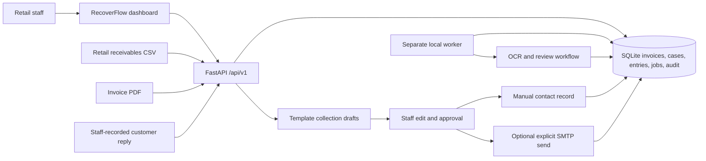
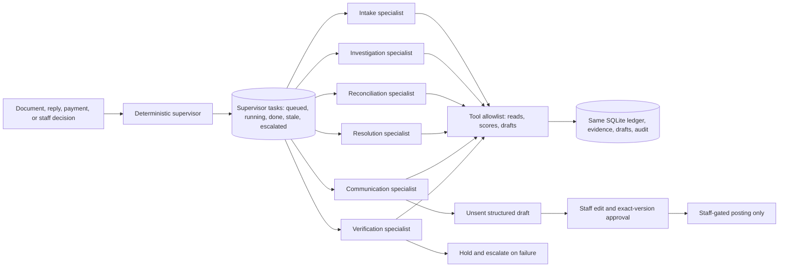

# RecoverFlow Release 1 architecture

The PNG files in `docs/images/` describe an earlier APEX concept. This page describes the code used by the current assisted release.

An invoice starts with an opening amount in integer cents. Signed receivable entries record payments, credits, and approved reversals. Current balance is the opening amount plus those entries. Staff review, opt-outs, disputes, stale balance checks, and contact cooldowns gate collection actions.

PDF jobs remain in the database until the separate worker claims them. The worker can retry failures and reclaim an expired processing lease. AR documents extracted from PDFs require staff confirmation before collections. The worker also stores an invoice-based DSO snapshot when there are recent AR invoices.

External accounting, payment, and inbound messaging connectors are placeholders. Their API routes return 503 until real providers are selected. Automated messaging and autonomous payment decisions are outside this release.

# P1 multi-agent workflow (added on top of Release 1)

The supervisor (`app/services/supervisor.py`) selects the next bounded task
from case stage, evidence freshness, uncertainty, payment state, and staff
decisions; every specialist output carries case ID/version, sources, claims,
confidence, proposed action, reason, and escalation conditions
(`app/services/specialists.py`). Tasks persist with idempotency keys,
attempts, budgets, case versions, and audit history, with pause, resume,
bounded retries, and crash recovery. Stale results are rejected when the
case fingerprint changes.

Money and actions stay server-owned: no specialist tool posts, reverses,
approves, waives, or sends. Allocation proposals hold ambiguous matches for
staff; promise records are nonfinancial; multilingual drafts are validated
before wording, after wording, and at approval. Details: [supervisor](supervisor.md),
[investigation](investigation.md), [payments](payments.md),
[communication](communication.md), [P1 evaluation](p1-evaluation.md), and the
[showcase walkthrough](showcase-walkthrough.md).
