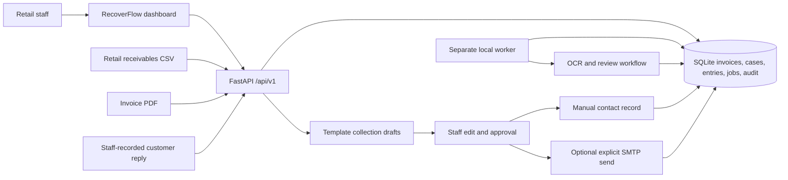

# RecoverFlow Release 1 architecture

The PNG files in `docs/images/` describe an earlier APEX concept. This page describes the code used by the current assisted release.

An invoice starts with an opening amount in integer cents. Signed receivable entries record payments, credits, and approved reversals. Current balance is the opening amount plus those entries. Staff review, opt-outs, disputes, stale balance checks, and contact cooldowns gate collection actions.

PDF jobs remain in the database until the separate worker claims them. The worker can retry failures and reclaim an expired processing lease. AR documents extracted from PDFs require staff confirmation before collections. The worker also stores an invoice-based DSO snapshot when there are recent AR invoices.

External accounting, payment, and inbound messaging connectors are placeholders. Their API routes return 503 until real providers are selected. Automated messaging and autonomous payment decisions are outside this release.
